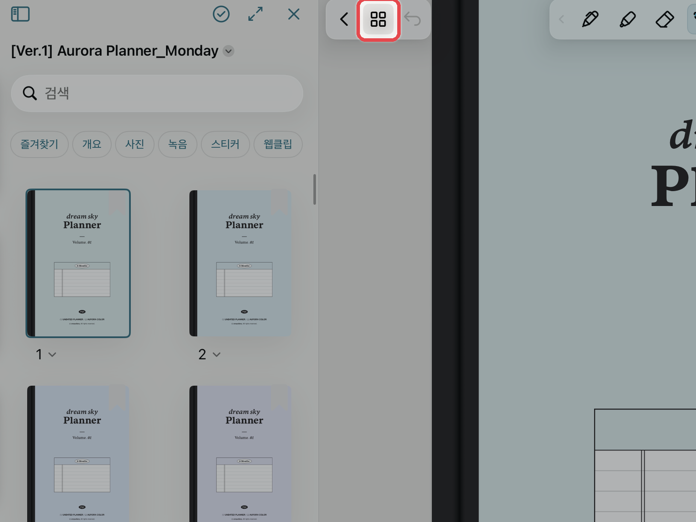
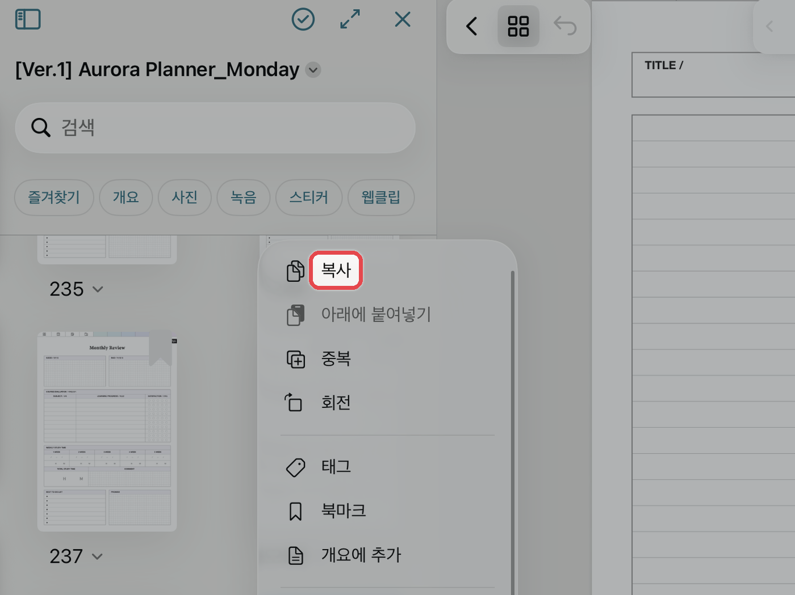
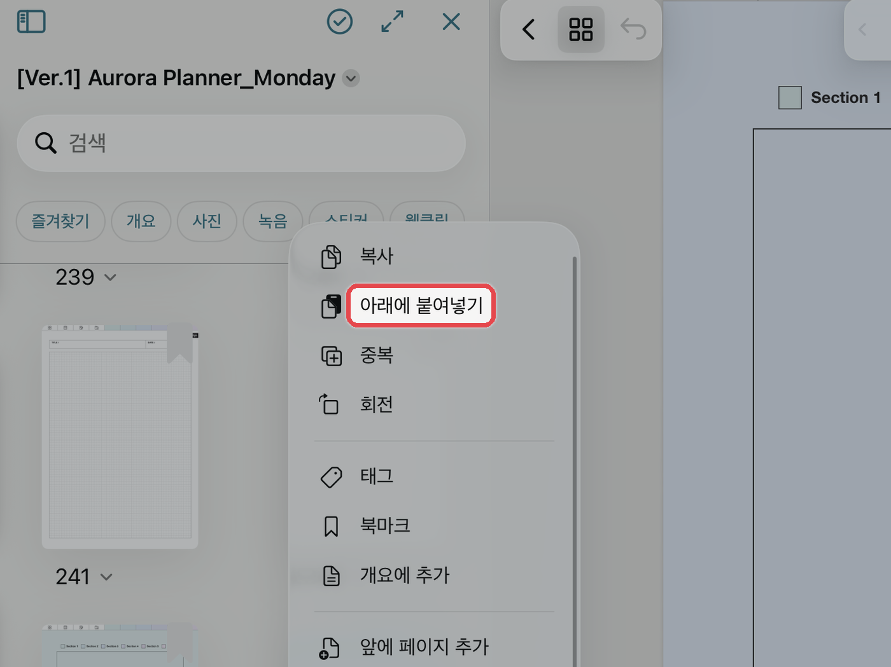

# 속지 추가하는 법


**노트쉘프 3** 기준 안내입니다.\
노트쉘프 1(이전 버전)은 메뉴 위치와 아이콘 모양이 다를 수 있습니다.




#### 페이지 목록 열기

왼쪽 위 **\[페이지 목록(사각형 4개 모양)]** 아이콘을 눌러주세요.

<figure><figcaption></figcaption></figure>



#### 속지 복사

추가할 속지의 **\[⌄]** → **\[복사]**&#xB97C; 눌러주세요.

<figure><figcaption></figcaption></figure>



#### 붙여넣기

넣고 싶은 위치 앞 속지의 **\[⌄]** → **\[아래에 붙여넣기]**&#xB97C; 눌러주세요.

<figure><figcaption></figcaption></figure>


