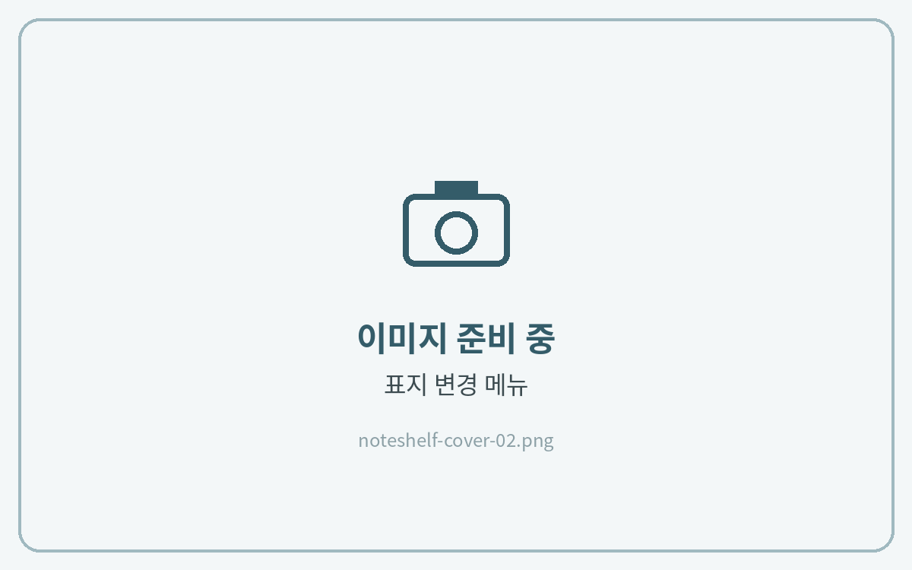

# 표지 변경하는 법

노트쉘프는 노트 바깥 표지(책장에 보이는 표지)를 이미지로 따로 지정할 수 있어요.



### 표지 이미지 저장

다운로드한 표지 파일(PNG)을 **사진 앱 또는 갤러리**에 저장해 주세요.



### 표지 변경 메뉴

노트쉘프 첫 화면에서 표지를 바꿀 노트를 **길게 누르고 → 표지 변경**을 눌러주세요.



### 사용자 지정 표지

**사용자 지정 → 사진 추가**를 눌러 저장해 둔 표지를 선택하고, 위치를 맞춘 뒤 적용해 주세요.



