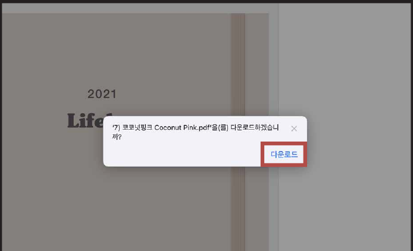
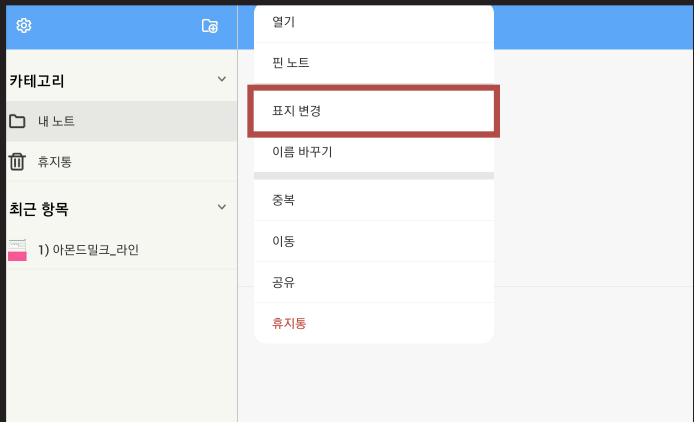
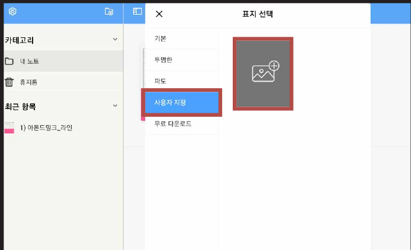
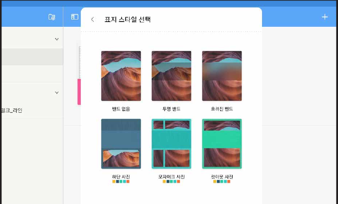
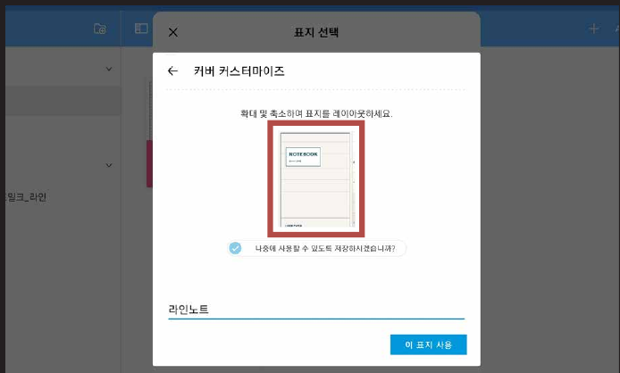
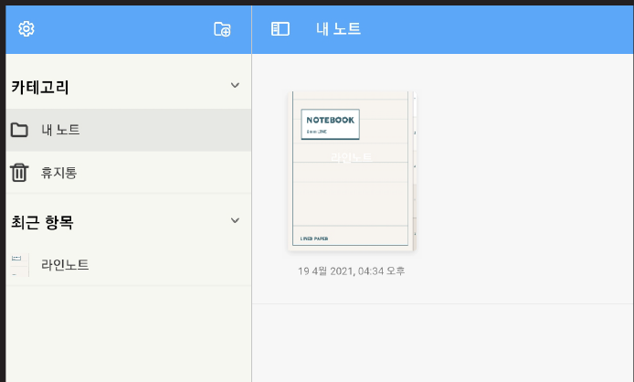

# 표지 변경하는 법

### STEP 01

[제품 다운로드 방법](download.md)과 동일하게 표지를 저장해 주세요.

### STEP 02

표지 변경을 원하는 **노트를 꾹 누르고** **표지 변경**을 눌러주세요.

### STEP 03

**사용자 지정**을 누르고 **사진 추가 아이콘**을 눌러주세요.

### STEP 04

원하는 **표지 스타일**을 선택해주세요.

### STEP 05

다운 받아둔 표지로 변경해줍니다. (표지 위치 조절 가능합니다)

### STEP 06

표지 적용 완료!
