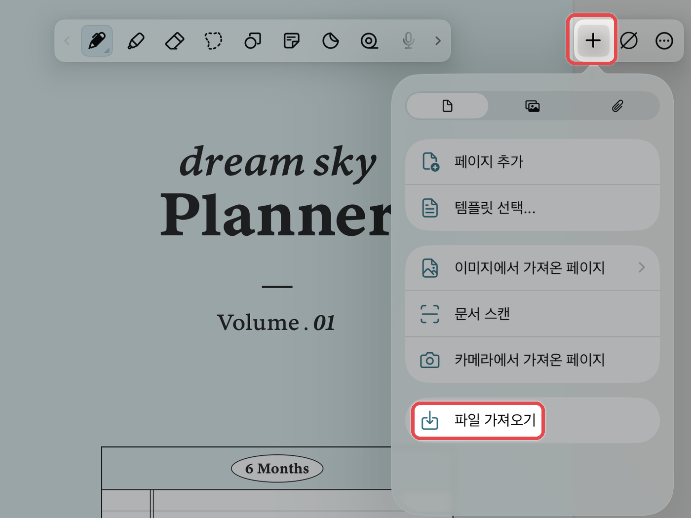
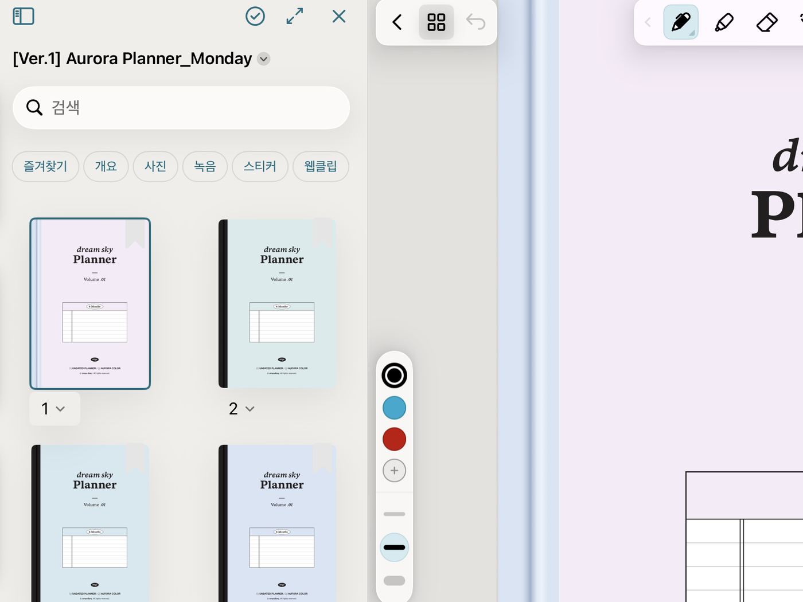

# 표지 변경하는 법


**노트쉘프 3** 기준 안내입니다.\
노트쉘프 1(이전 버전)은 메뉴 위치와 아이콘 모양이 다를 수 있습니다.


노트쉘프에서는 **노트의 첫 속지가 표지**로 보입니다.\
표지 이미지를 추가한 뒤 맨 앞으로 옮겨 변경합니다.



#### 표지 이미지 추가

표지를 바꿀 노트에서 오른쪽 위 **\[+]** → **\[파일 가져오기]**&#xB97C; 누르고, 저장해 둔 표지 이미지를 선택해 주세요.

<figure><figcaption></figcaption></figure>



#### 맨 앞으로 옮기기

왼쪽 위 **\[페이지 목록(사각형 4개 모양)]** 아이콘을 눌러주세요.\
추가된 표지를 **길게 누른 채 맨 앞으로** 옮겨주세요.

<figure><figcaption></figcaption></figure>




노트 안에 이미 원하는 표지 속지가 있다면, 페이지 목록에서 그 속지를 **맨 앞으로 이동**해도 표지가 바뀝니다.

