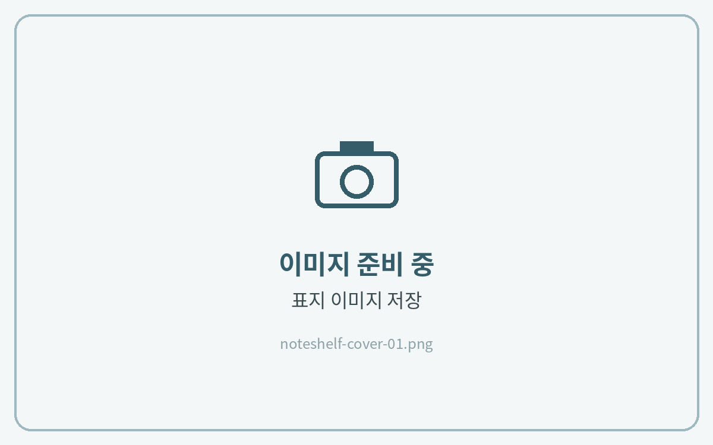
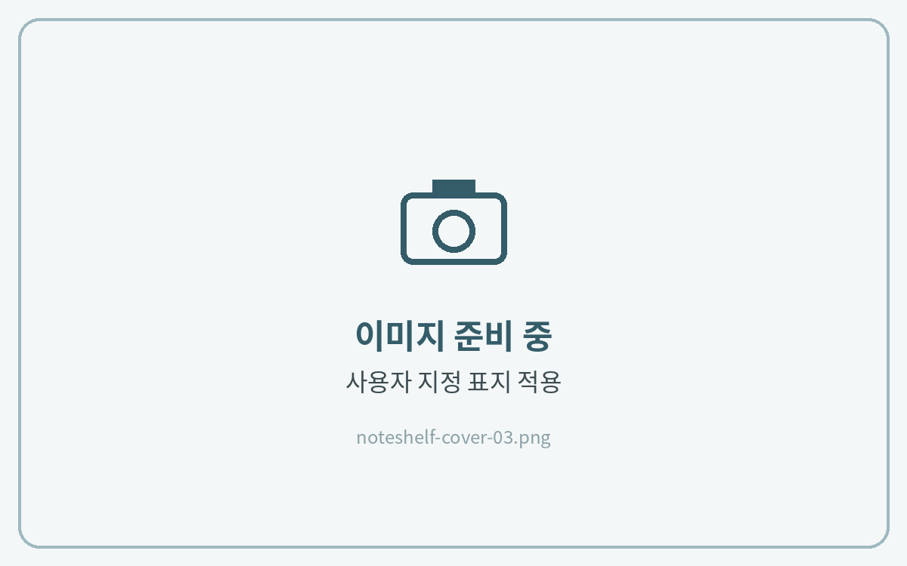

# 표지 변경하는 법


**노트쉘프 3** 기준 안내입니다.\
노트쉘프 1(이전 버전)은 메뉴 위치와 아이콘 모양이 다를 수 있습니다.


노트쉘프는 책장에 보이는 **노트 표지를 이미지로 따로 지정**할 수 있습니다.



**표지 이미지 저장**

다운로드한 표지 파일(PNG)을 **사진 앱** 또는 **갤러리**에 저장해 주세요.

<figure><figcaption></figcaption></figure>



**표지 변경 메뉴 열기**

노트쉘프 첫 화면에서 표지를 바꿀 노트를 **길게 누르고** **\[표지 변경]**&#xC744; 눌러주세요.

<figure><figcaption></figcaption></figure>



**사용자 지정 표지 적용**

**\[사용자 지정]** → **\[사진 추가]**&#xB97C; 눌러 저장해 둔 표지를 선택하고, 위치를 맞춘 뒤 적용해 주세요.

<figure><figcaption></figcaption></figure>


