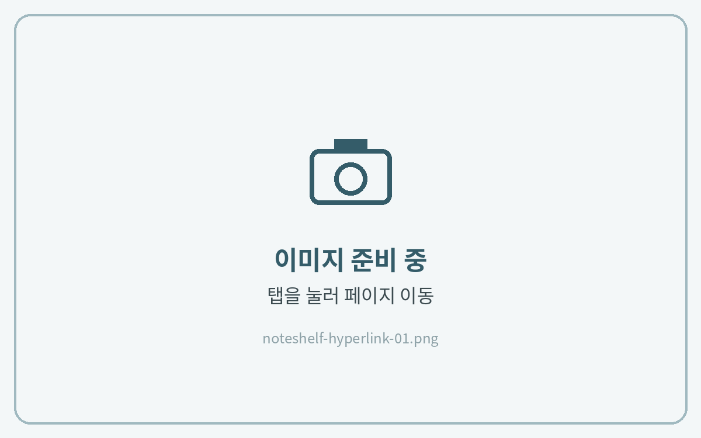

# 하이퍼링크 사용법



**링크 누르기**

탭이나 목차를 **손가락으로 짧게 탭**하면 해당 페이지로 이동해요.

<figure><figcaption></figcaption></figure>



**이동이 안 될 때**

펜이 선택된 상태에서 링크가 반응하지 않으면, 도구 막대에서 **보기(손 모양) 모드**로 바꾼 뒤 다시 눌러주세요.

<figure><figcaption></figcaption></figure>


