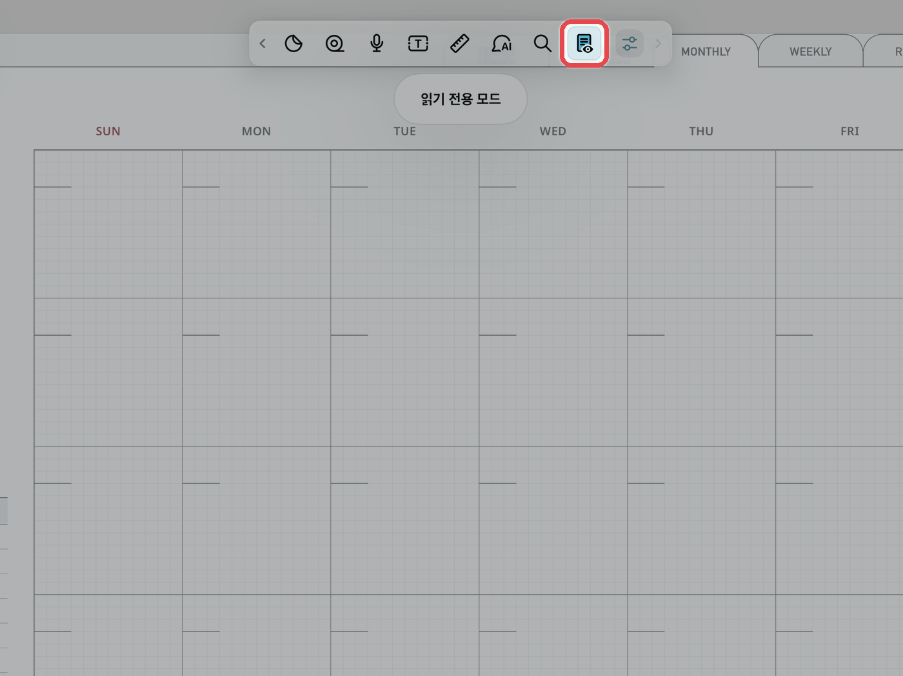
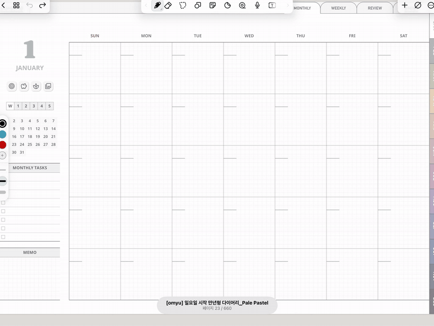
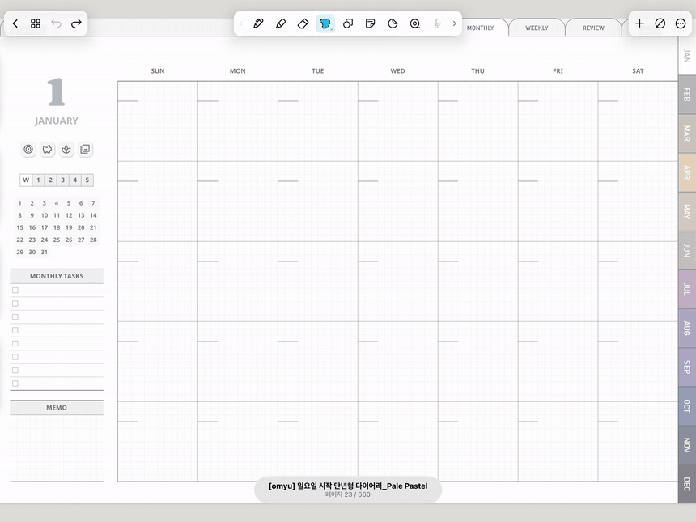

# 하이퍼링크 사용법


**노트쉘프 3** 기준 안내입니다.\
노트쉘프 1(이전 버전)은 메뉴 위치와 아이콘 모양이 다를 수 있습니다.


노트쉘프는 **읽기 전용 모드**에서 링크를 눌러 속지를 이동합니다.



#### 읽기 전용 모드 켜기

상단 도구 막대의 **\[읽기 전용 모드]** 아이콘을 눌러주세요.\
화면에 **읽기 전용 모드** 안내가 나오면 켜진 상태예요.

<figure><figcaption></figcaption></figure>



#### 링크를 눌러 이동

하이퍼링크 버튼이 있는 곳을 누르면 해당 속지로 이동해요.

<figure><figcaption></figcaption></figure>



#### 도구 막대 옮기기

도구 막대가 탭을 가린다면 도구 막대를 **길게 누른 채** 원하는 위치로 끌어다 놓아주세요.

<figure><figcaption></figcaption></figure>


