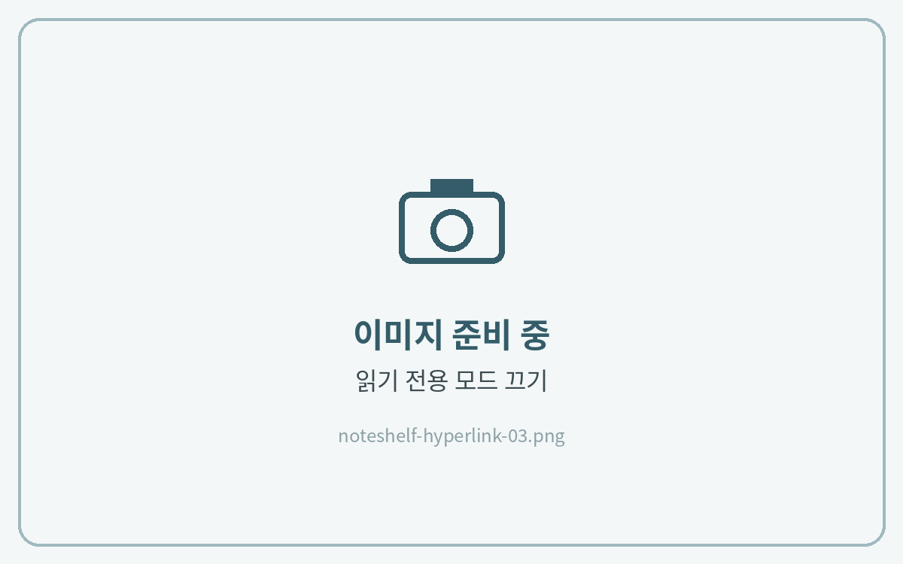

# 하이퍼링크 사용법

노트쉘프는 **읽기 전용 모드에서 링크가 눌립니다.**\
페이지를 이동할 때는 읽기 전용 모드를 켜고, 필기할 때는 다시 끕니다.



**읽기 전용 모드 켜기**

상단 도구 막대의 **\[읽기 전용 모드]** 아이콘을 눌러주세요.

<figure><figcaption></figcaption></figure>



**링크를 눌러 이동**

하이퍼링크 버튼이 있는 곳을 누르면 해당 페이지로 이동해요.

<figure><figcaption></figcaption></figure>



**다시 필기하기**

필기할 때는 **\[읽기 전용 모드]** 아이콘을 한 번 더 눌러 꺼주세요.

<figure><figcaption></figcaption></figure>


