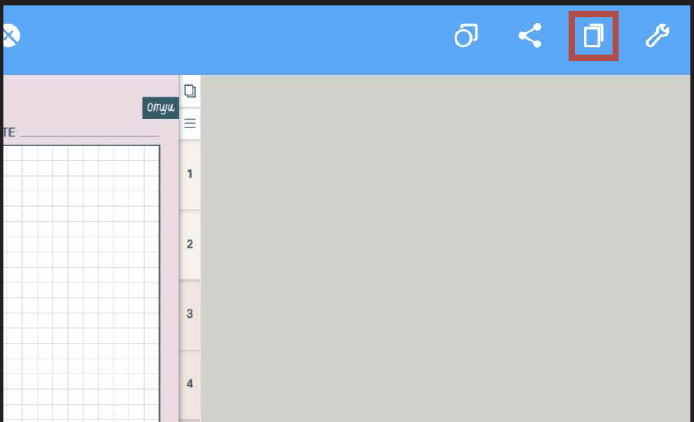
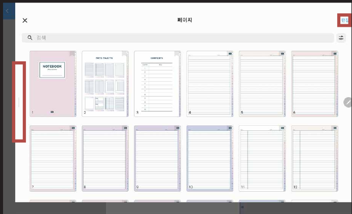
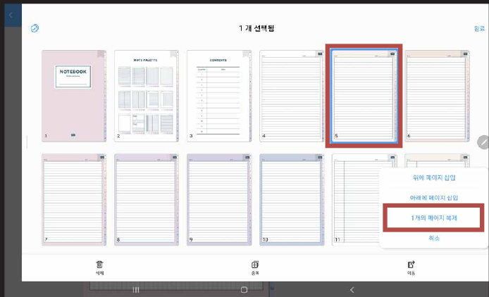
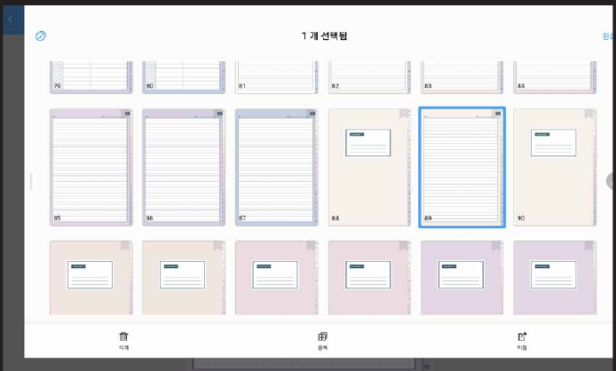

# 노트팔레트 사용방법


노트팔레트(NOTE PALETTE)가 있는 제품에만 해당됩니다!
(예: 올라운드 노트 / 올데이 언어노트 / 유어컬러 언어노트 / 워크윗미 노트)


### STEP 01

**책 모양 아이콘**을 눌러주세요.

### STEP 02

페이지 창을 크게 키우고 **편집**을 눌러주세요.

### STEP 03

원하는 페이지를 선택한 후 **페이지 복제**를 눌러주세요.

### STEP 04

노트쉘프는 복제된 페이지를 **드래그**해서 바인더 뒤에 옮겨 와야 합니다!
