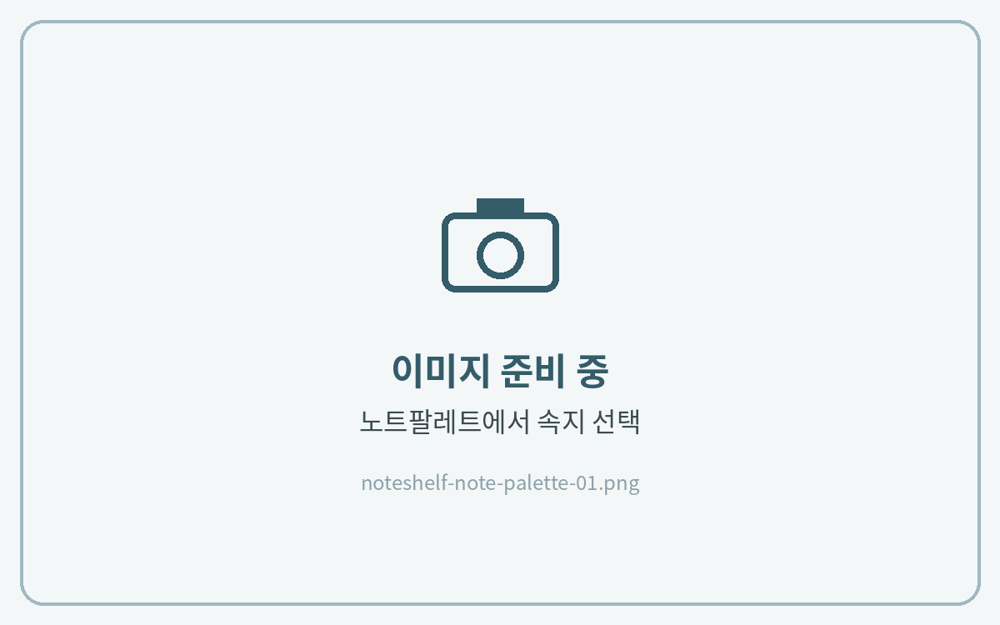
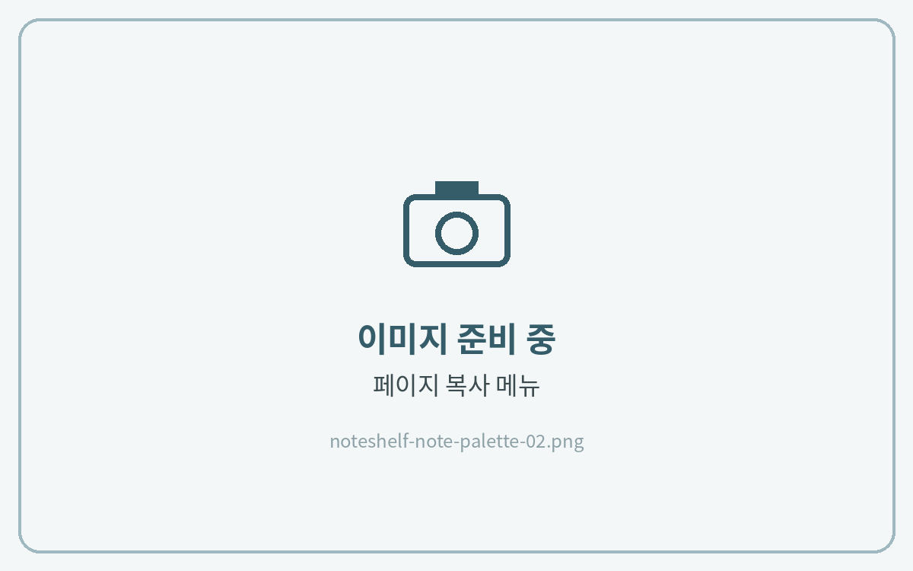
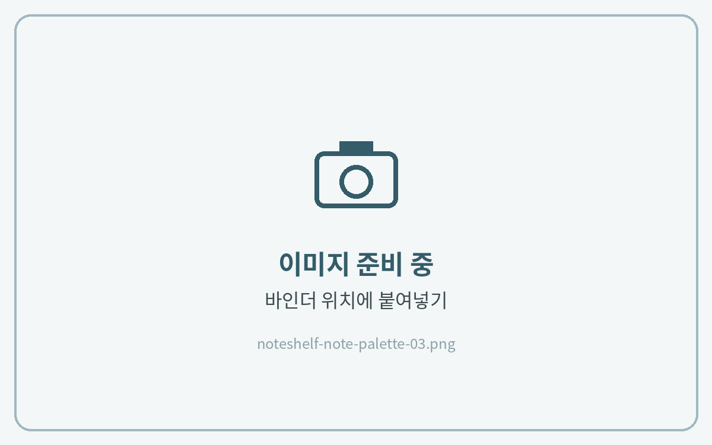

# 노트팔레트 사용하는 법


**노트쉘프 3** 기준 안내입니다.\
노트쉘프 1(이전 버전)은 메뉴 위치와 아이콘 모양이 다를 수 있습니다.



**노트팔레트(NOTE PALETTE)가 포함된 제품에만 해당됩니다.**\
예) 올라운드 노트 · 올데이 언어노트 · 유어컬러 언어노트 · 워크윗미 노트


**노트팔레트**는 여러 가지 속지를 한곳에 모아 둔 페이지입니다.\
필요한 속지를 골라 바인더(노트 본문)에 복사해 사용합니다.



#### 원하는 속지 찾기

**\[페이지 목록(사각형 4개 모양)]** 아이콘을 열고 노트팔레트의 원하는 속지를 찾아주세요.

<figure><figcaption></figcaption></figure>



#### 속지 복제

목록 위쪽의 **\[✓]** 체크 아이콘을 누르고 해당 페이지를 선택한 뒤 **\[복제]**&#xB97C; 눌러주세요.

<figure><figcaption></figcaption></figure>



#### 바인더로 옮기기

복제된 페이지를 **길게 눌러 드래그**해서 바인더의 원하는 위치로 옮겨주세요.

<figure><figcaption></figcaption></figure>




노트쉘프는 복사·붙여넣기 대신 **복제 후 드래그**로 위치를 옮깁니다.

