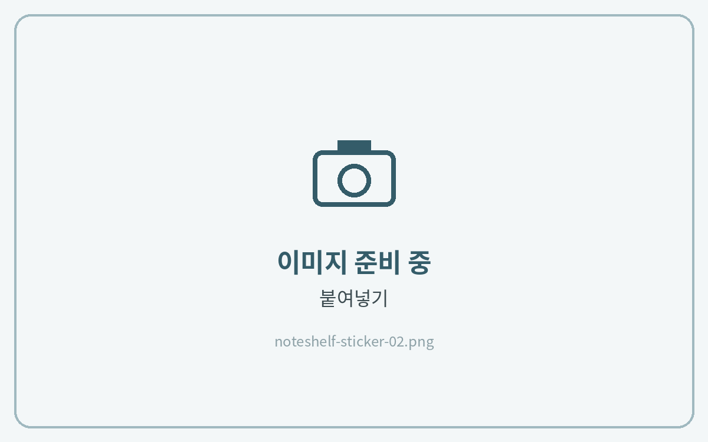
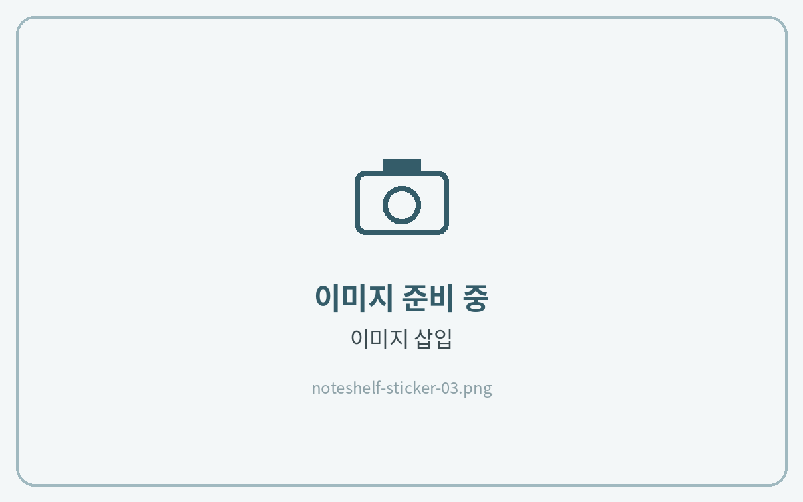
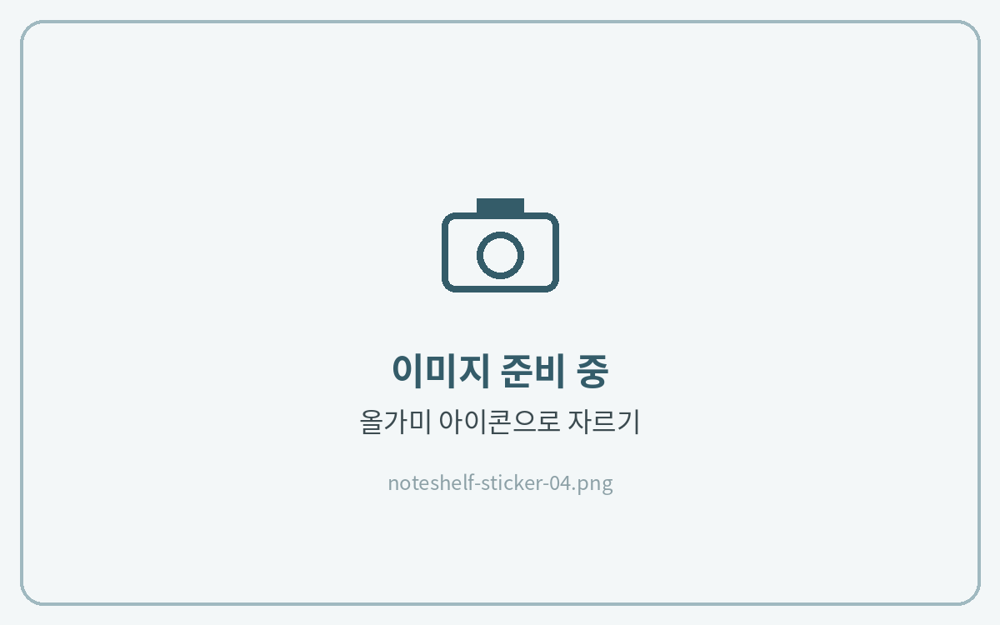
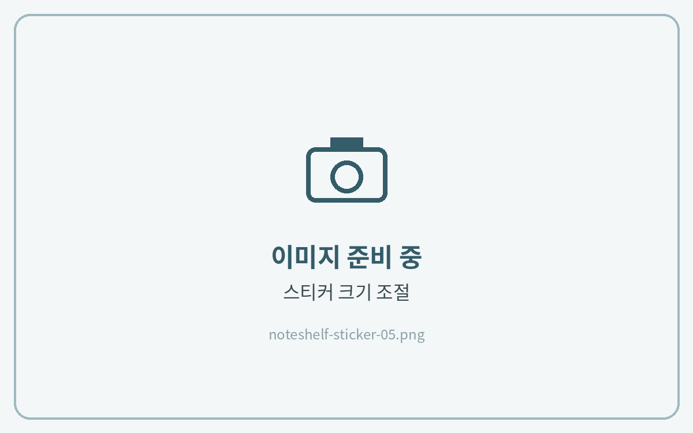

# 스티커 사용법


**노트쉘프 3** 기준 안내입니다.\
노트쉘프 1(이전 버전)은 메뉴 위치와 아이콘 모양이 다를 수 있습니다.


## 컷팅 스티커북



**스티커 복사**

**\[올가미 도구]**&#xB85C; 스티커 둘레를 그려 선택하고 **\[복사]**&#xB97C; 눌러주세요.

<figure><figcaption></figcaption></figure>



**노트에 붙여넣기**

노트의 원하는 곳을 길게 누르고 **\[붙여넣기]**&#xB97C; 눌러주세요.

<figure><figcaption></figcaption></figure>



## PNG 스티커



**이미지 삽입**

**\[+]** → **\[이미지]**&#xC5D0;서 저장해 둔 PNG 스티커를 선택해 주세요.

<figure><figcaption></figcaption></figure>



**필요한 부분만 자르기**

삽입한 이미지를 누르고 **\[편집]** → **\[올가미]** 아이콘으로 필요한 영역을 그린 뒤 **\[완료]**&#xB97C; 눌러주세요.

<figure><figcaption></figcaption></figure>



**크기 조절**

모서리를 드래그해 크기와 위치를 맞추면 완성이에요.

<figure><figcaption></figcaption></figure>


