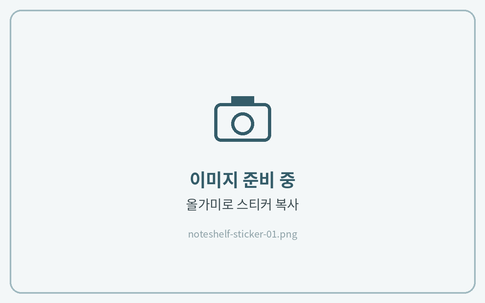
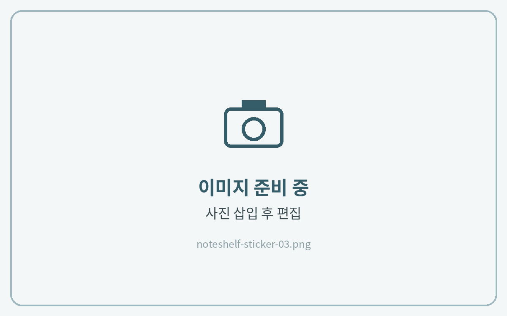

# 스티커 사용법

## 컷팅 스티커



**스티커 복사**

**올가미 도구**로 스티커 둘레를 그려 선택하고 **복사**를 눌러주세요.

<figure><figcaption></figcaption></figure>



**노트에 붙여넣기**

노트로 돌아가 빈 곳을 길게 누르고 **붙여넣기**를 눌러주세요.

<figure><figcaption></figcaption></figure>




## PNG 스티커



**사진 삽입**

**+ → 사진**에서 저장해 둔 스티커를 열고 **편집**을 눌러주세요.

<figure><figcaption></figcaption></figure>



**자르기**

**가위 아이콘**을 누르고 필요한 영역을 그린 뒤 **완료**를 눌러주세요.

<figure><figcaption></figcaption></figure>



**크기 조절**

모서리를 드래그해 크기와 위치를 맞추면 완성이에요.

<figure><figcaption></figcaption></figure>



