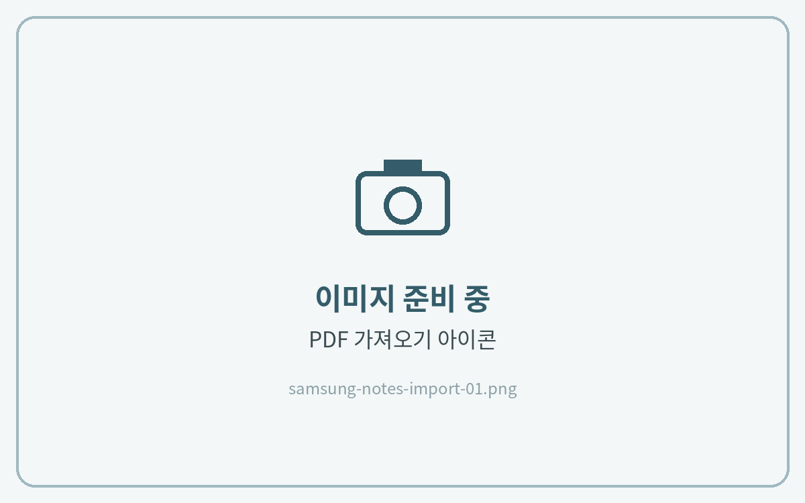
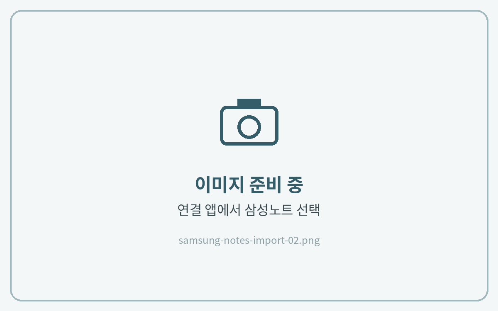

# 📄 삼성노트 (Samsung Notes)

**지원 기기** · 갤럭시탭 · 갤럭시폰

## 노트 불러오기



#### 삼성노트에서 PDF 가져오기

삼성노트 첫 화면 오른쪽 아래의 **\[노트 작성]** 버튼을 길게 누르고, **\[PDF 가져오기]**&#xB97C; 눌러주세요.\
압축을 푼 PDF 파일을 선택하고 **\[완료]**&#xB97C; 누르면 돼요.

<figure><figcaption></figcaption></figure>



#### 내 파일 앱에서 바로 보내기

내 파일 앱에서 PDF 파일을 누르고, 우측 상단의 **\[...]** 더보기 → **\[다른 앱에서 열기]** → **\[삼성 노트]**&#xB97C; 눌러주세요.\
**\[노트에 추가]**&#xB97C; 꼭 눌러주세요.

<figure><figcaption></figcaption></figure>




PDF를 가져오면 원본 파일은 그대로 두고 **복사본**이 삼성노트에 만들어집니다.


## 기능별 가이드

<table data-view="cards"><thead><tr><th></th><th></th><th data-hidden data-card-target data-type="content-ref"></th></tr></thead><tbody><tr><td><h4>하이퍼링크 사용법</h4></td><td>목차와 탭을 눌러 원하는 페이지로 이동합니다</td><td><a href="hyperlink.md">hyperlink.md</a></td></tr><tr><td><h4>스티커 사용법</h4></td><td>컷팅 스티커와 PNG 스티커를 붙이는 방법입니다</td><td><a href="sticker.md">sticker.md</a></td></tr><tr><td><h4>표지 변경하는 법</h4></td><td>원하는 표지로 변경하는 방법입니다</td><td><a href="cover.md">cover.md</a></td></tr><tr><td><h4>페이지 추가하는 법</h4></td><td>필요한 속지를 복사해 추가합니다</td><td><a href="add-page.md">add-page.md</a></td></tr><tr><td><h4>노트팔레트 사용하는 법</h4></td><td>원하는 속지를 바인더에 추가합니다</td><td><a href="note-palette.md">note-palette.md</a></td></tr><tr><td><h4>목록 아이콘이 안보일 때</h4></td><td>페이지 목록 아이콘이 보이지 않을 때 설정합니다</td><td><a href="list-icon.md">list-icon.md</a></td></tr></tbody></table>
