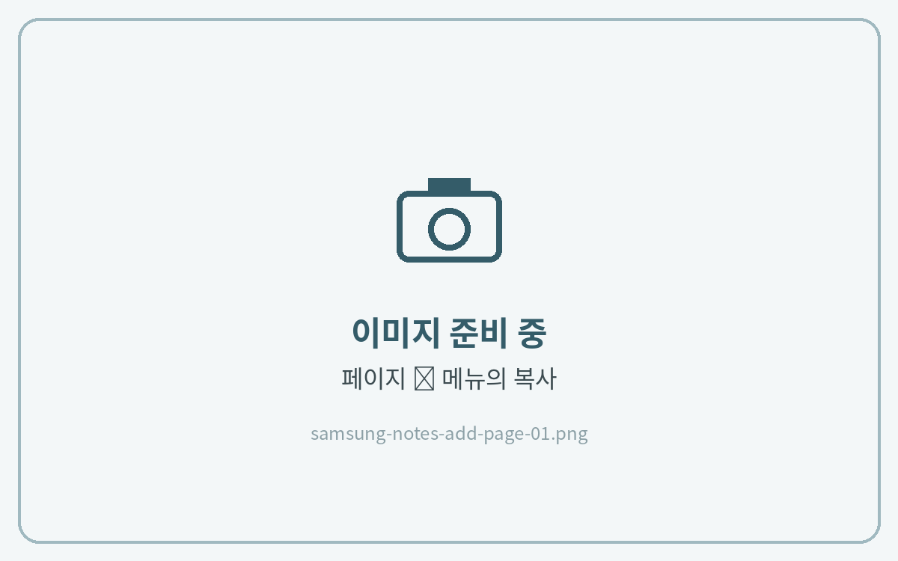
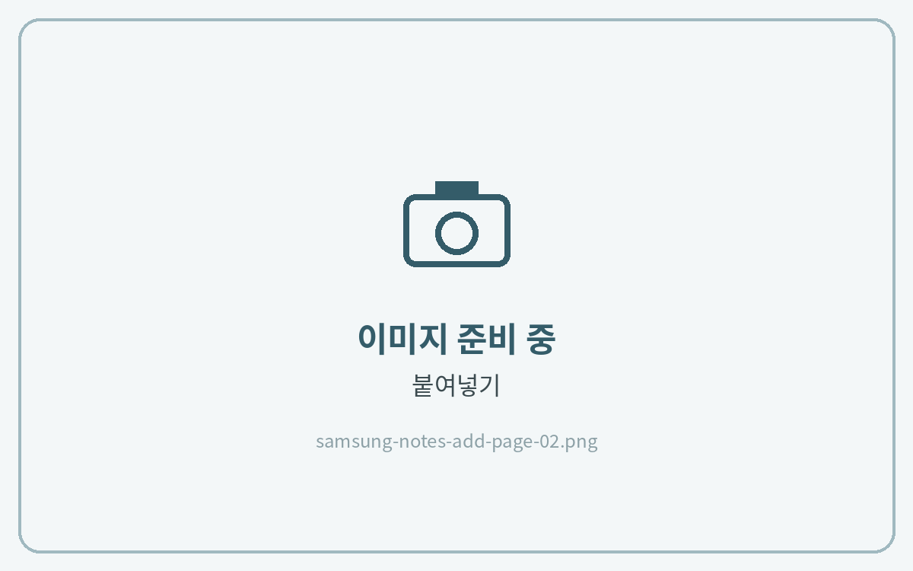

# 페이지 추가하는 법



**페이지 복사**

**목록 아이콘**을 누르고, 추가할 페이지의 **⋮ → 복사**를 눌러주세요.

<figure><figcaption></figcaption></figure>



**붙여넣기**

넣고 싶은 위치 앞 페이지의 **⋮ → 붙여넣기**를 눌러주세요.

<figure><figcaption></figcaption></figure>





**목록 아이콘**이 안 보인다면 → [목록 아이콘이 안보일 때](list-icon.md)

