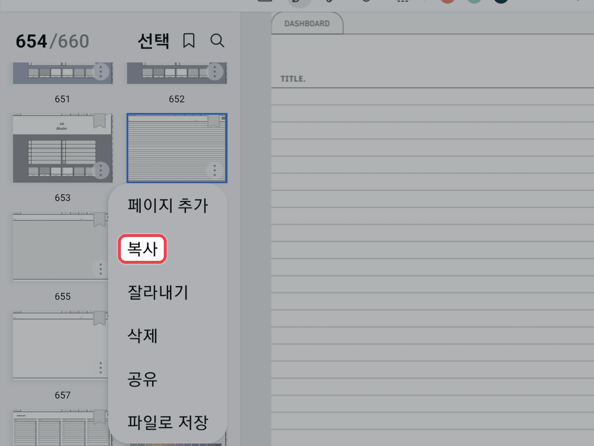
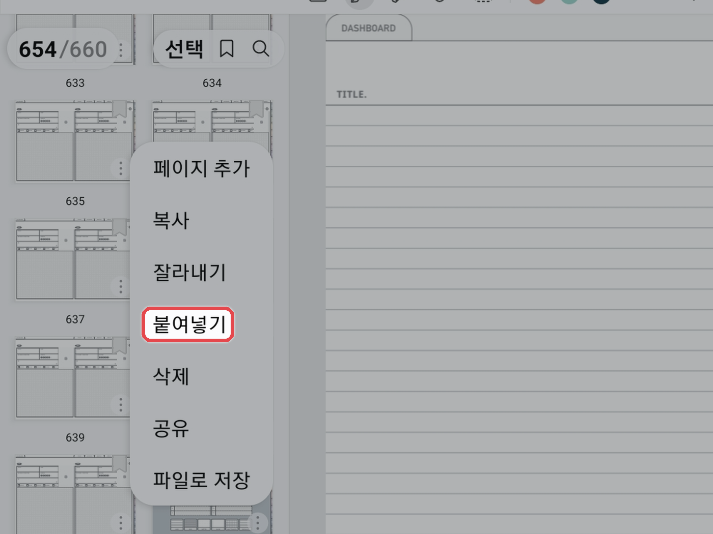

# 속지 추가하는 법



#### 속지 복사

오른쪽 상단의 **\[목록]** 아이콘을 누르고, 추가할 속지의 **\[⋮]** → **\[복사]**&#xB97C; 눌러주세요.

<figure><figcaption></figcaption></figure>



#### 붙여넣기

넣고 싶은 위치 앞 속지의 **\[⋮]** → **\[붙여넣기]**&#xB97C; 눌러주세요.

<figure><figcaption></figcaption></figure>


