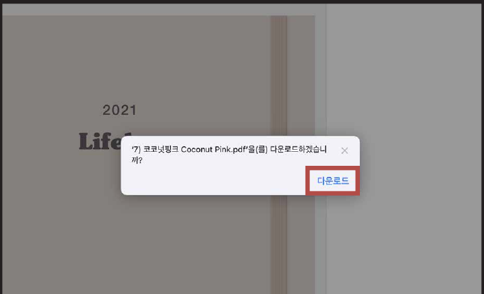
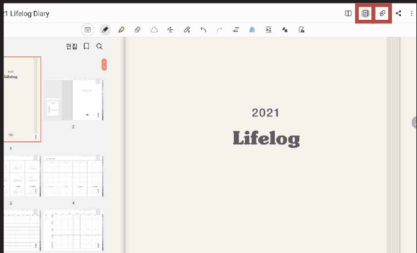
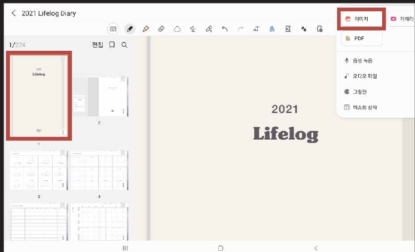
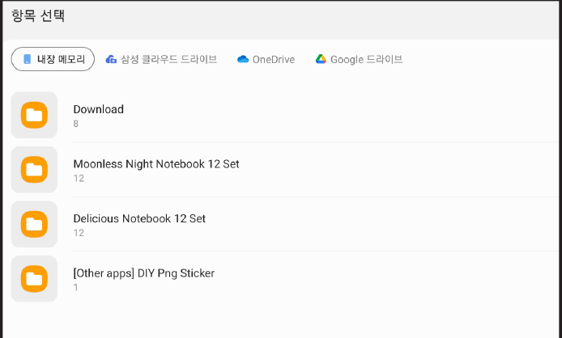
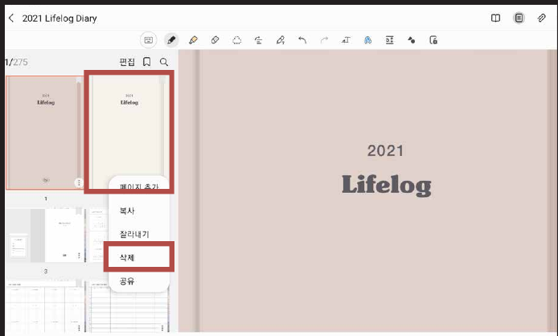

# 표지 변경하는 법

### STEP 01

[제품 다운로드 방법](download.md)과 동일하게 표지를 저장해 주세요.

### STEP 02

**목록 아이콘**을 누르고 변경할 표지의 위치를 누른 후 **클립 아이콘**을 눌러주세요.

### STEP 03

**이미지**를 눌러주세요.

### STEP 04

다운로드에서 받아둔 표지를 열어줍니다.

### STEP 05

이전 표지는 **삭제**를 눌러주세요.


**목록 아이콘**이 안 보인다면? → [목록 아이콘 생성 방법](list-icon.md)

