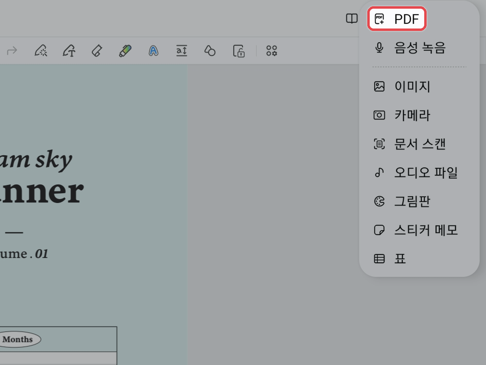
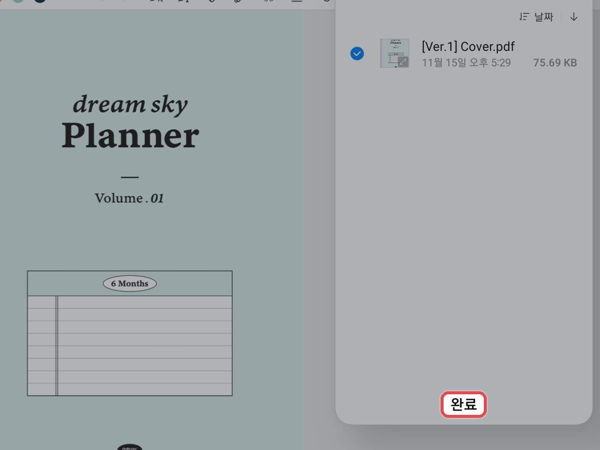
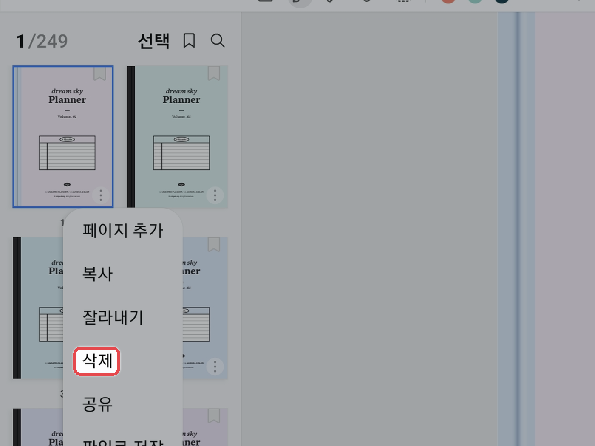

# 표지 변경하는 법

삼성노트에서는 **노트의 첫 속지가 표지**가 됩니다.\
노트 안에 있는 표지를 맨 앞으로 옮기거나, 다운로드한 표지 파일을 맨 앞에 추가해 변경합니다.

## 방법 1 · 노트 안의 표지로 바꾸기



#### 원하는 표지를 맨 앞으로 이동

상단의 **\[목록]** 아이콘을 눌러 속지 목록을 열고, 원하는 표지 속지를 **길게 누른 채 맨 앞으로** 옮겨주세요.



## 방법 2 · 다운로드한 표지 파일로 바꾸기



#### PDF 추가

우측 상단의 **\[+]** 버튼 → **\[PDF]**&#xB97C; 눌러주세요.

<figure><figcaption></figcaption></figure>



#### 표지 파일 선택

원하는 표지 파일을 선택하고 **\[완료]**&#xB97C; 눌러주세요.

<figure><figcaption></figcaption></figure>



#### 위치 정리 · 기존 표지 삭제

새 표지를 맨 앞으로 드래그하고, 기존 표지는 **\[⋮]** → **\[삭제]**&#xB97C; 눌러 지워주세요.

<figure><figcaption></figcaption></figure>




노트와 표지 파일의 **방향(가로·세로)이 같아야** 삽입됩니다.\
가로 노트에는 가로 표지, 세로 노트에는 세로 표지를 사용해 주시기 바랍니다.

