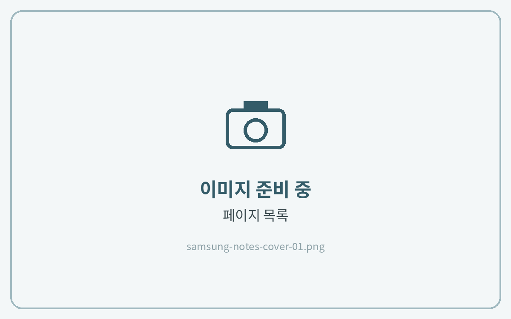
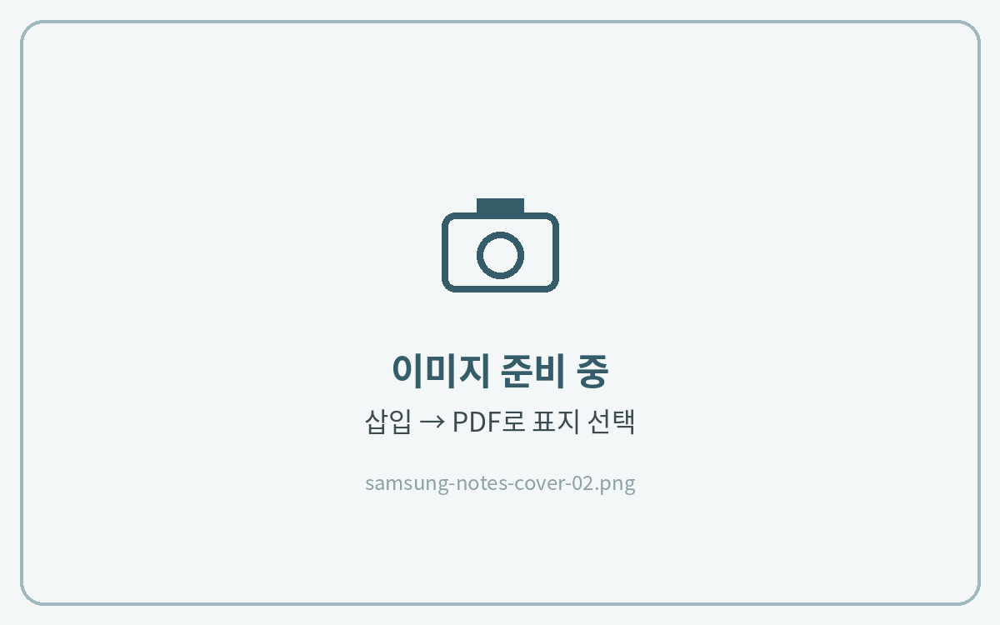
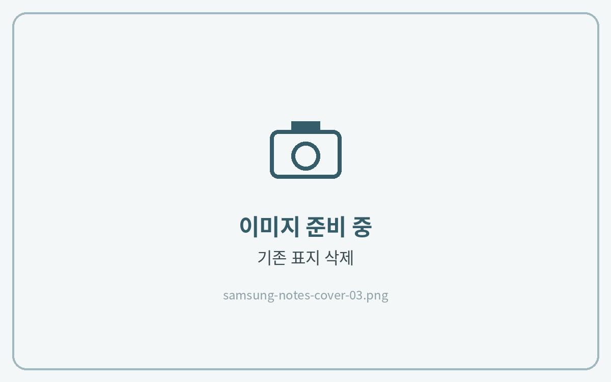

# 표지 변경하는 법



#### 페이지 목록 열기

상단의 **\[목록]** 아이콘을 눌러 페이지 목록을 열고, 기존 표지(1페이지)를 선택해 주세요.

<figure><figcaption></figcaption></figure>



#### 표지 파일 삽입

상단의 **\[+]** 삽입 아이콘 → **\[PDF]**(이미지 표지는 **\[이미지]**)를 누르고, 다운로드해 둔 표지 파일을 선택해 주세요.

<figure><figcaption></figcaption></figure>



#### 위치 정리 · 기존 표지 삭제

새 표지를 맨 앞으로 드래그하고, 기존 표지는 **\[⋮]** → **\[삭제]**&#xB97C; 눌러 지워주세요.

<figure><figcaption></figcaption></figure>




노트와 표지 파일의 **방향(가로·세로)이 같아야** 삽입됩니다.\
가로 노트에는 가로 표지, 세로 노트에는 세로 표지를 사용해 주시기 바랍니다.



**목록 아이콘**이 보이지 않는다면 [목록 아이콘이 안보일 때](list-icon.md)를 참고해 주시기 바랍니다.

