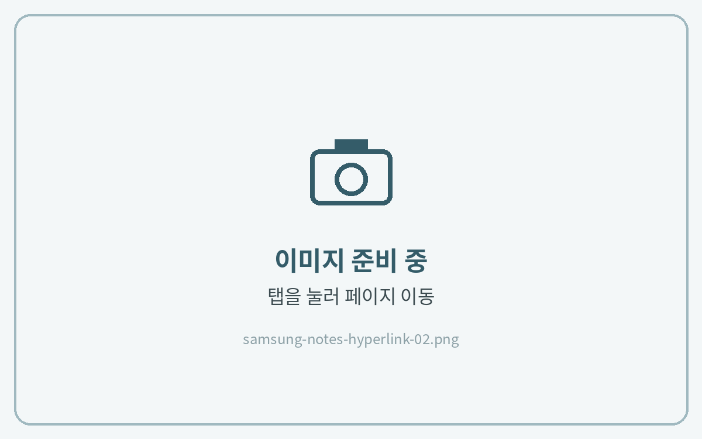
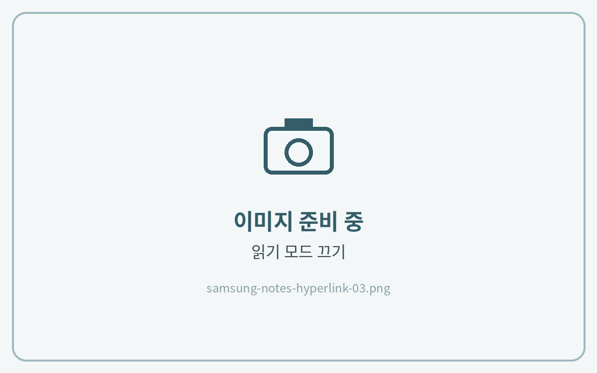

# 하이퍼링크 사용법

삼성노트는 **읽기 모드에서만 링크가 눌립니다.**\
페이지를 이동할 때는 읽기 모드를 켜고, 필기할 때는 다시 끕니다.



**읽기 모드 켜기**

상단의 **\[읽기 모드(책 모양)]** 아이콘을 눌러주세요.

<figure><figcaption></figcaption></figure>



**링크를 눌러 이동**

하이퍼링크 버튼이 있는 곳을 누르면 해당 페이지로 이동해요.

<figure><figcaption></figcaption></figure>



**읽기 모드 끄고 필기하기**

필기할 때는 **\[읽기 모드(책 모양)]** 아이콘을 한 번 더 눌러 읽기 모드를 꺼주세요.

<figure><figcaption></figcaption></figure>




페이지가 위아래로 이어져 보이면 [목록 아이콘이 안보일 때](list-icon.md)를 참고해 **페이지가 구분된 노트**로 변경해 주시기 바랍니다.

