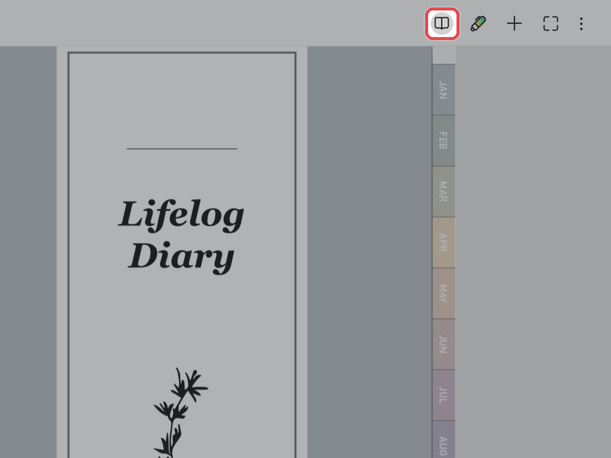

# 하이퍼링크 사용법

삼성노트는 **읽기 모드에서만 링크가 눌립니다.**\
속지를 이동할 때는 읽기 모드를 켜 주시기 바랍니다.



#### 읽기 모드 켜기

상단의 **\[읽기 모드(책 모양)]** 아이콘을 눌러주세요.

<figure><figcaption></figcaption></figure>



#### 링크를 눌러 이동

하이퍼링크 버튼이 있는 곳을 누르면 해당 속지로 이동해요.

<figure><figcaption></figcaption></figure>


