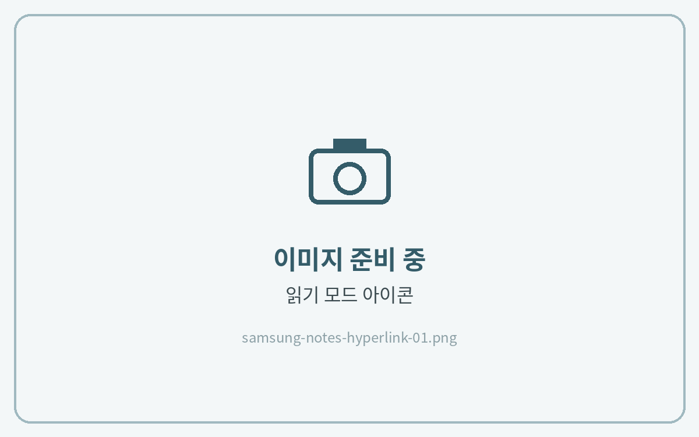
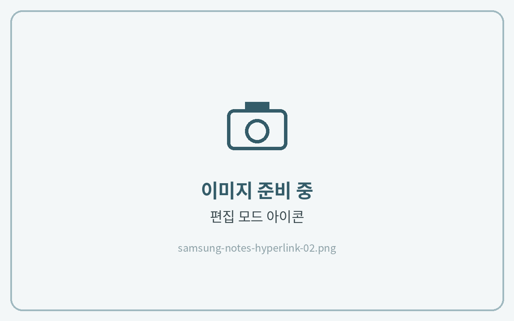

# 하이퍼링크 사용법



**읽기 모드에서 이동**

오른쪽 위 **읽기 모드(책 아이콘)** 를 누른 뒤 탭이나 목차를 누르면 해당 페이지로 이동해요.

<figure><figcaption></figcaption></figure>



**편집 모드에서 필기**

필기할 때는 **편집(펜) 아이콘**을 눌러 편집 모드로 돌아와 주세요. 편집 모드에서는 링크가 눌리지 않아요.

<figure><figcaption></figcaption></figure>





페이지가 위아래로 이어져 보이면 [목록 아이콘이 안보일 때](list-icon.md)를 참고해 **페이지가 구분된 노트**로 바꿔 주세요.

