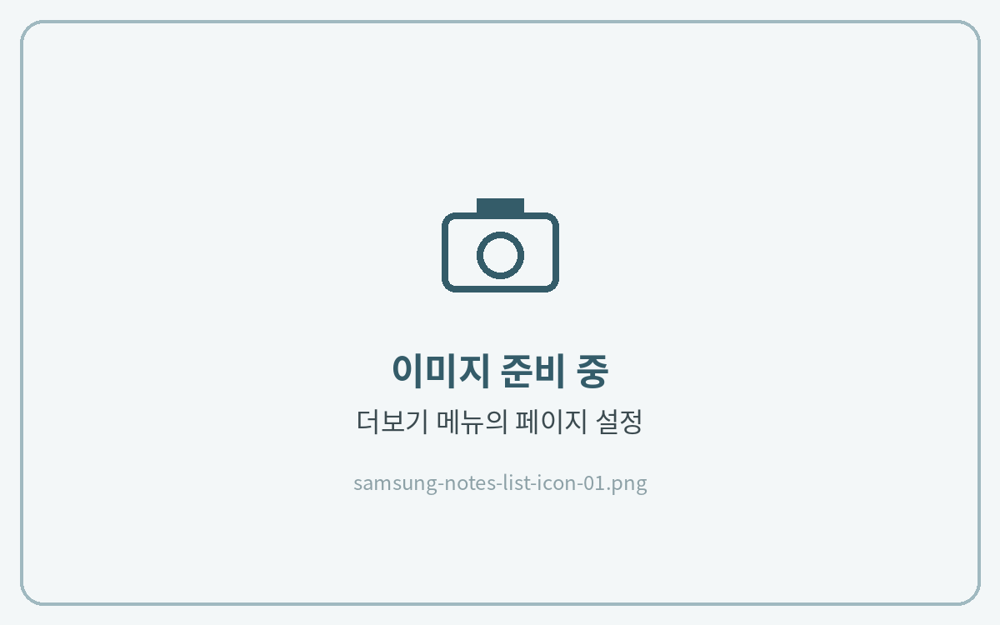
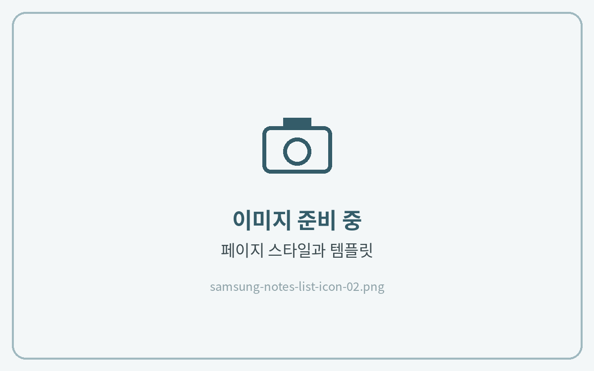
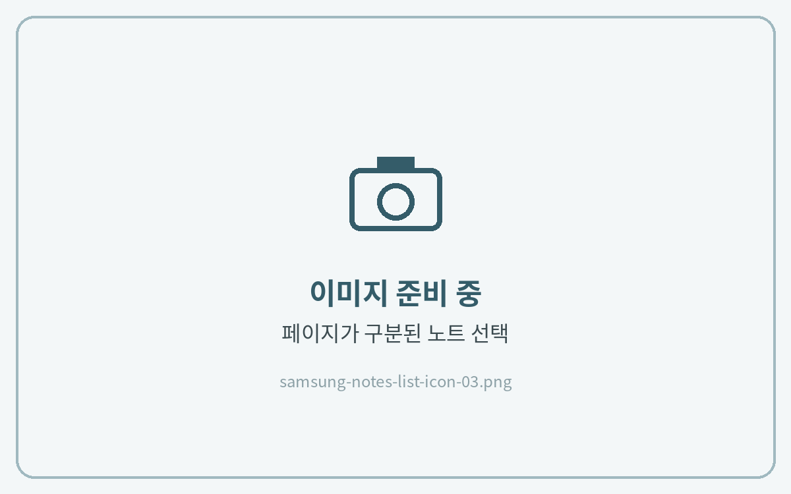

# 목록 아이콘이 안보일 때

페이지가 위아래로 이어진 **스크롤형 노트**로 열리면 목록 아이콘이 나타나지 않아요. **페이지가 구분된 노트**로 바꿔 주세요.



**설정 열기**

노트를 연 상태에서 오른쪽 위 **⋮ (더보기) → 페이지 설정**(또는 톱니바퀴 아이콘)을 눌러주세요.

<figure><figcaption></figcaption></figure>



**페이지 스타일 선택**

**페이지 스타일과 템플릿**을 눌러주세요.

<figure><figcaption></figcaption></figure>



**페이지가 구분된 노트 선택**

**페이지가 구분된 노트**를 선택하면 오른쪽 위에 목록 아이콘이 나타나요.

<figure><figcaption></figcaption></figure>



