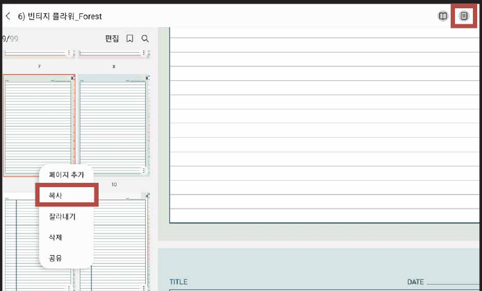
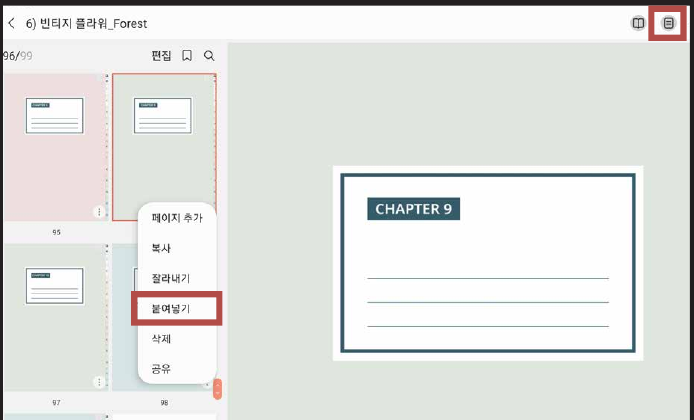

# 노트팔레트 사용방법


노트팔레트(NOTE PALETTE)가 있는 제품에만 해당됩니다!
(예: 올라운드 노트 / 올데이 언어노트 / 유어컬러 언어노트 / 워크윗미 노트)


### STEP 01

**목록 아이콘**을 누르고 원하는 페이지의 ⋮ 를 누른 후 **복사**를 눌러주세요.

### STEP 02

**바인더로 이동**한 후 **붙여넣기**를 눌러주세요.


**목록 아이콘**이 안 보인다면? → [목록 아이콘 생성 방법](list-icon.md)

