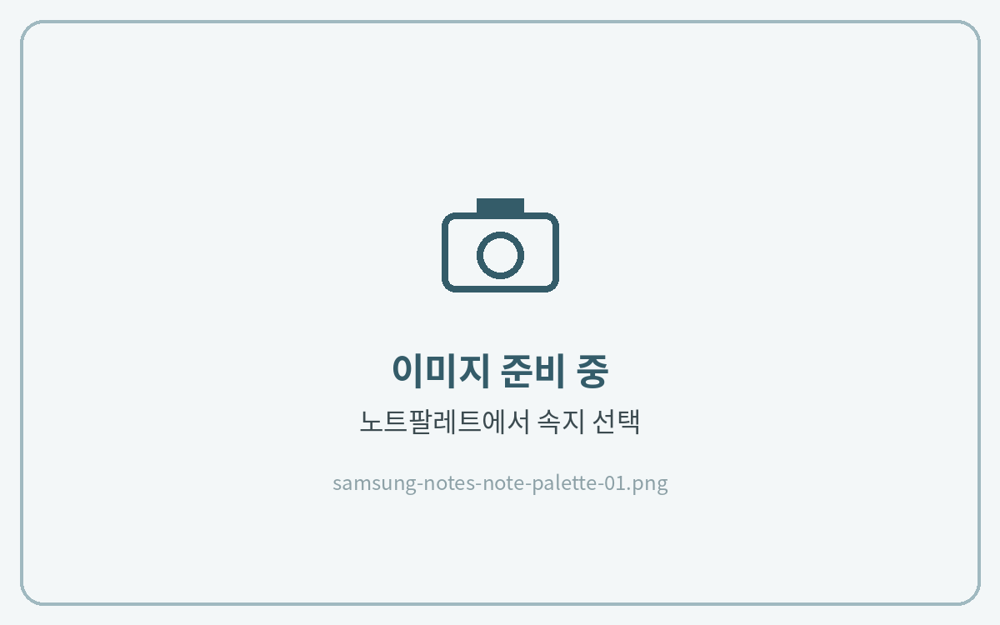
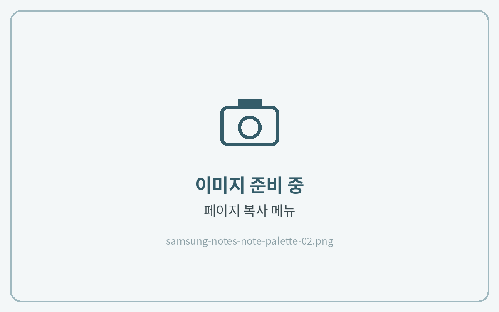
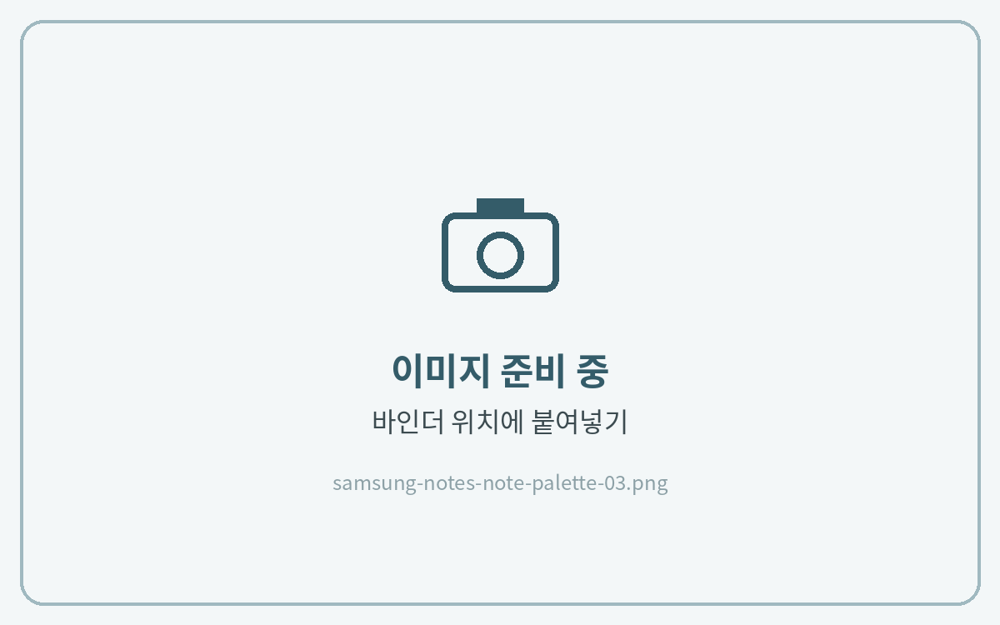

# 노트팔레트 사용하는 법


**노트팔레트(NOTE PALETTE)가 포함된 제품에만 해당돼요.**
예) 올라운드 노트 · 올데이 언어노트 · 유어컬러 언어노트 · 워크윗미 노트


**노트팔레트**는 여러 가지 속지를 한곳에 모아 둔 페이지예요. 필요한 속지를 골라 내 바인더(노트 본문)에 복사해 쓰는 방식이에요.



### 원하는 속지로 이동

**읽기 모드**에서 노트팔레트의 원하는 속지를 눌러 이동해 주세요.



### 속지 복사

**목록 아이콘**을 누르고 해당 페이지의 **⋮ → 복사**를 눌러주세요.



### 바인더에 붙여넣기

바인더의 원하는 위치에서 **⋮ → 붙여넣기**를 눌러주세요.



