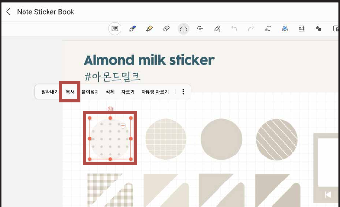
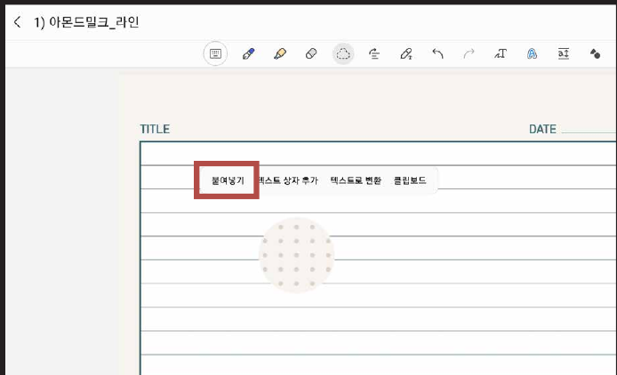
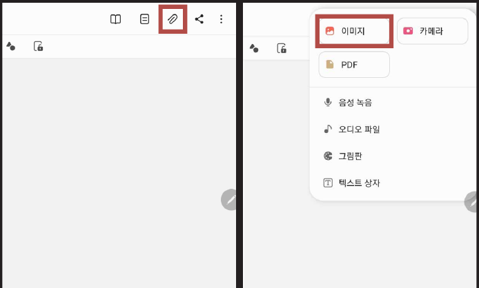
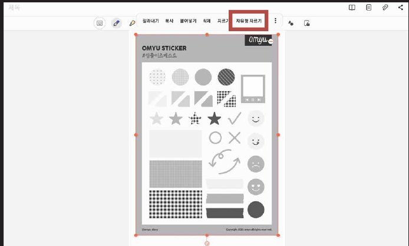
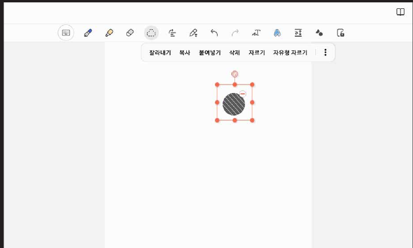

# 스티커 사용방법

## 컷팅 스티커

### STEP 01

**스티커**를 선택한 후 **복사**를 눌러주세요.

### STEP 02

스티커가 필요한 파일을 열고 **붙여넣기**를 눌러주세요.

## PNG 스티커

### STEP 01

**클립 아이콘**을 누른 후 **이미지**를 눌러 스티커 파일을 열어주세요.

### STEP 02

**자유형 자르기**를 누른 후 필요한 영역을 그려주세요.

### STEP 03

크기에 맞게 조절해서 사용하시면 됩니다!
