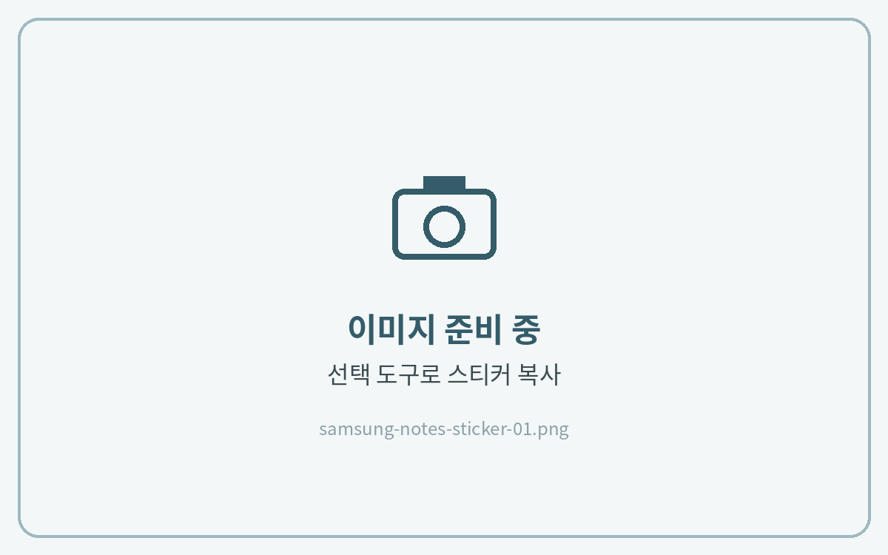
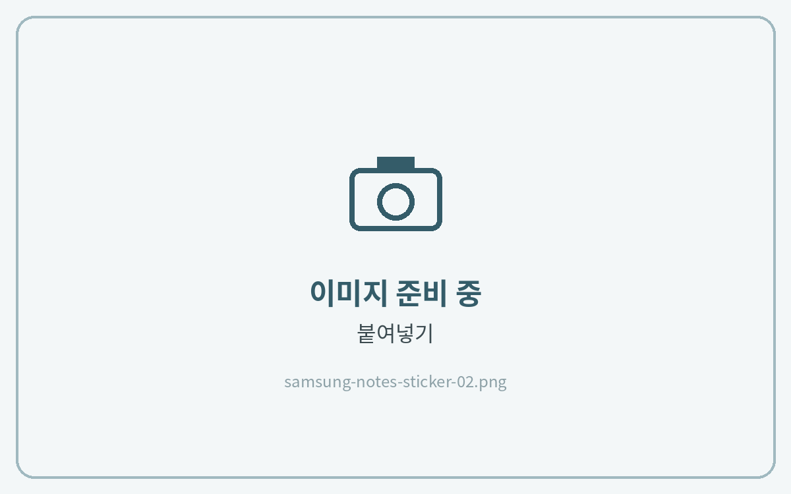
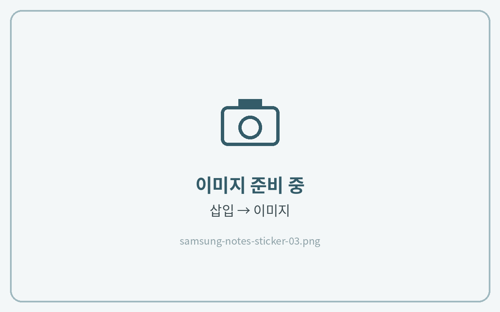
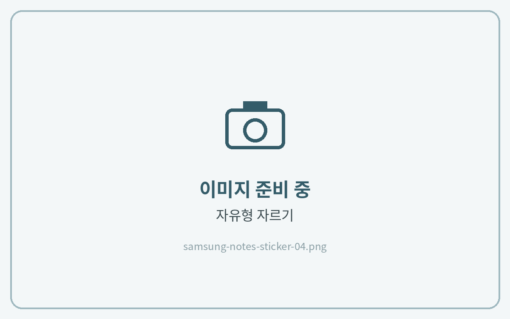
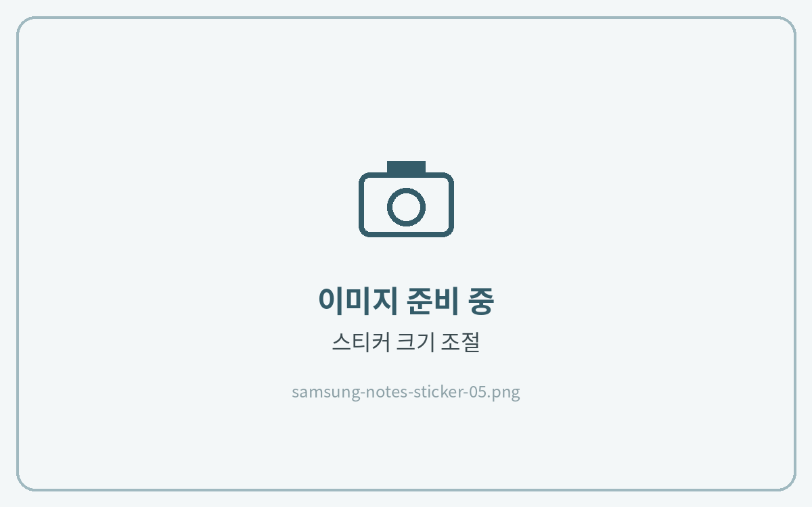

# 스티커 사용법

## 컷팅 스티커북



#### 스티커 선택 후 복사

스티커북에서 **\[선택 도구(올가미)]**&#xB85C; 원하는 스티커를 선택하고 **\[복사]**&#xB97C; 눌러주세요.

<figure><figcaption></figcaption></figure>



#### 노트에 붙여넣기

노트의 원하는 곳을 길게 누르고 **\[붙여넣기]**&#xB97C; 눌러주세요.

<figure><figcaption></figcaption></figure>



## PNG 스티커



#### 이미지 삽입

상단의 **\[+]** 삽입 아이콘 → **\[이미지]**&#xB97C; 누르고, 갤러리에서 PNG 스티커를 선택해 주세요.

<figure><figcaption></figcaption></figure>



#### 필요한 부분만 자르기

삽입한 이미지를 누르고 **\[자르기]**&#xB97C; 눌러 필요한 부분만 남겨주세요.

<figure><figcaption></figcaption></figure>



#### 크기 조절

모서리를 드래그해 크기와 위치를 맞추면 완성이에요.

<figure><figcaption></figcaption></figure>


