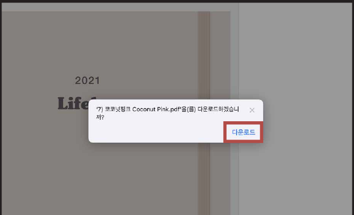
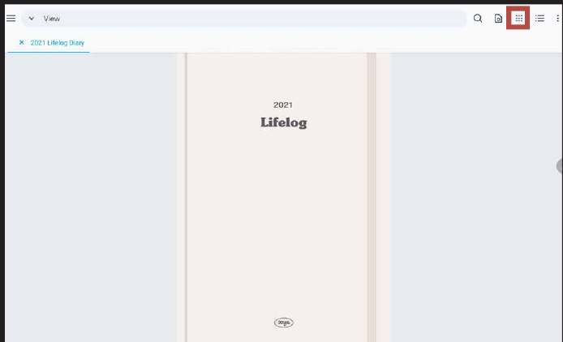
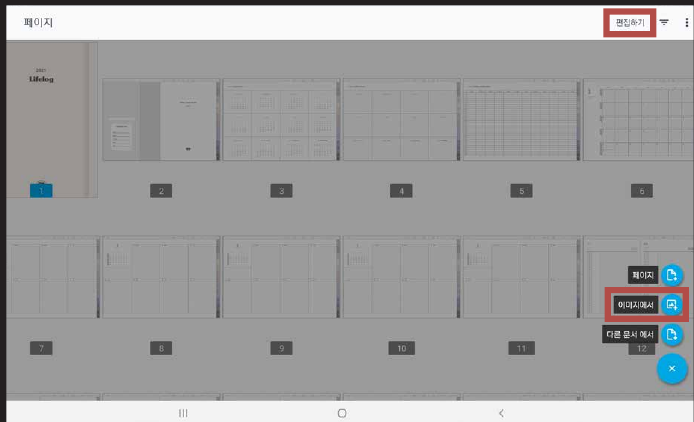
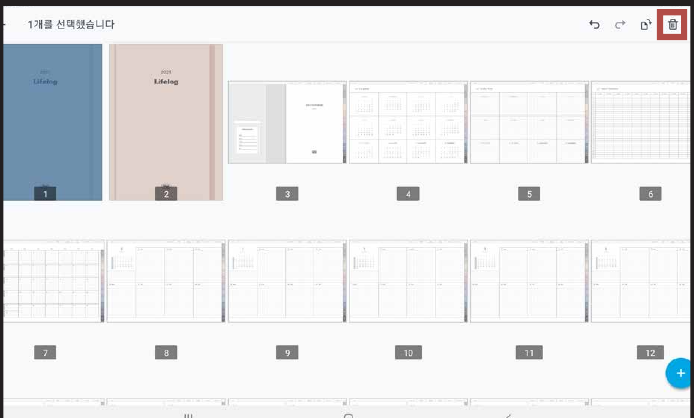

# 표지 변경하는 법

### STEP 01

[제품 다운로드 방법](download.md)과 동일하게 표지를 저장해 주세요.

### STEP 02

우측 상단의 **점 아이콘**을 눌러주세요.

### STEP 03

표지를 누르고 **편집하기**를 누른 후 **이미지에서**를 눌러 표지 파일을 열어주세요.

### STEP 04

이전 표지는 **삭제**하셔도 됩니다.
