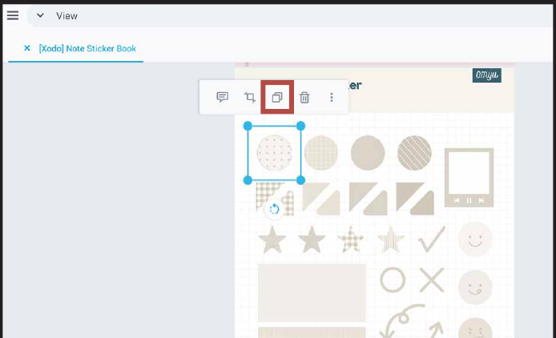
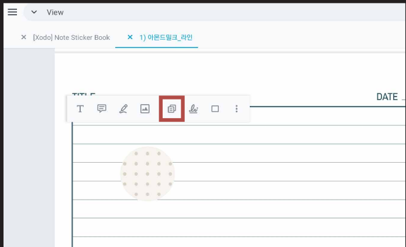
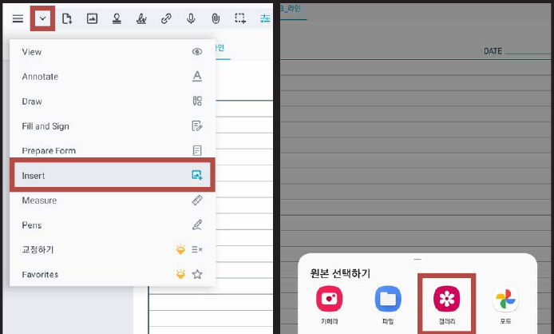
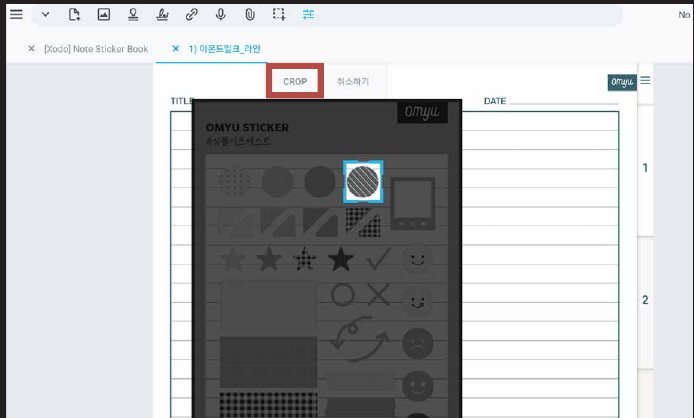
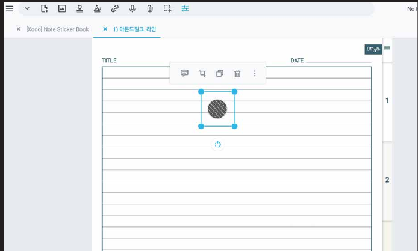

# 스티커 사용방법

## 컷팅 스티커

### STEP 01

**스티커**를 선택한 후 **복사 아이콘**을 눌러주세요.

### STEP 02

스티커가 필요한 파일을 열고 **붙여넣기 아이콘**을 눌러주세요.

## PNG 스티커

### STEP 01

좌측 상단의 화살표를 누르고 **Insert**를 누르고 갤러리를 눌러주세요.

### STEP 02

스티커 사진을 불러온 후 **CROP**을 눌러 스티커를 잘라주세요.

### STEP 03

크기에 맞게 조절해서 사용하시면 됩니다!
